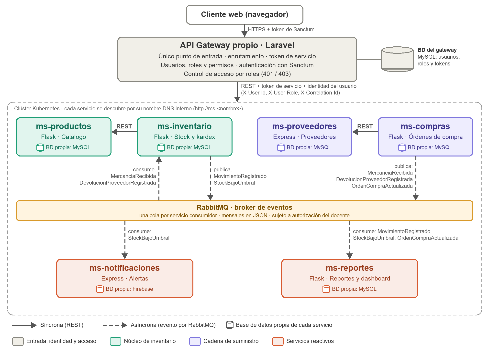
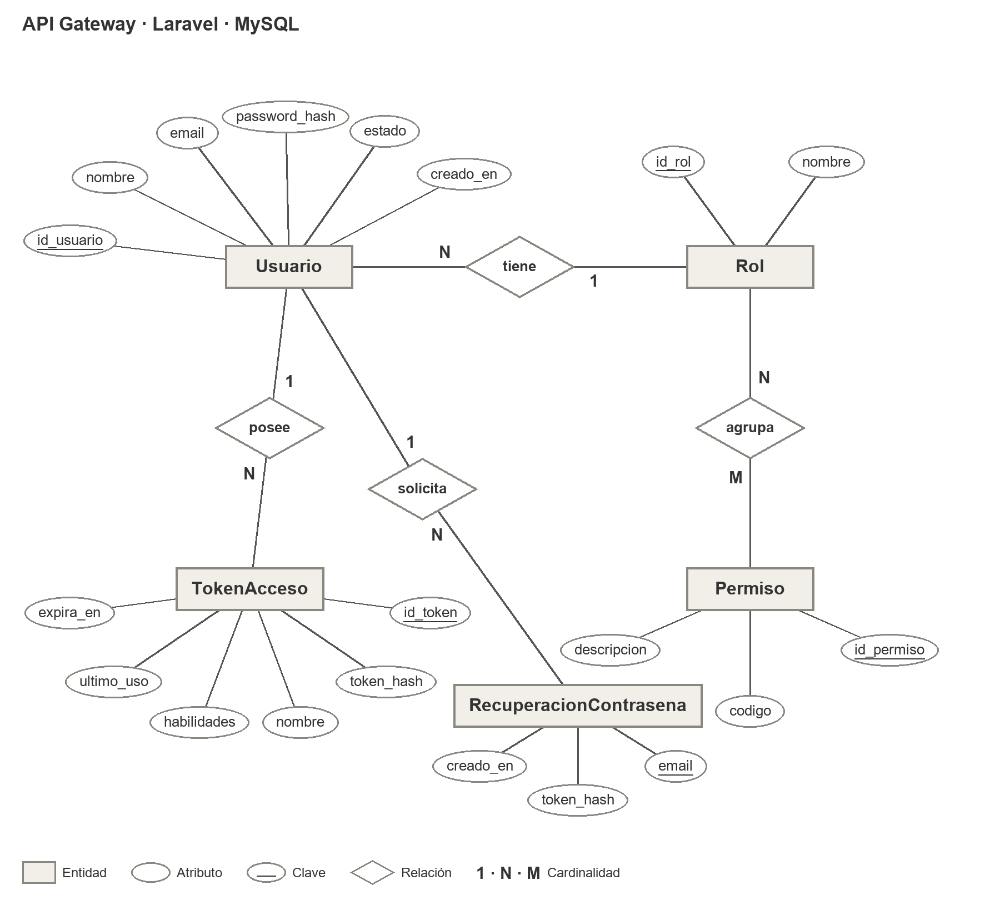
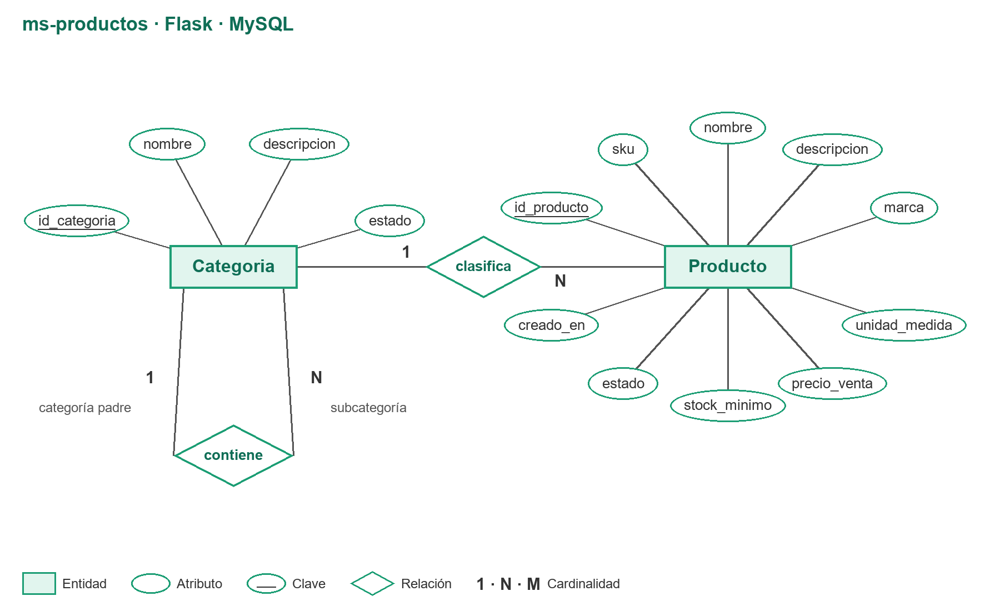
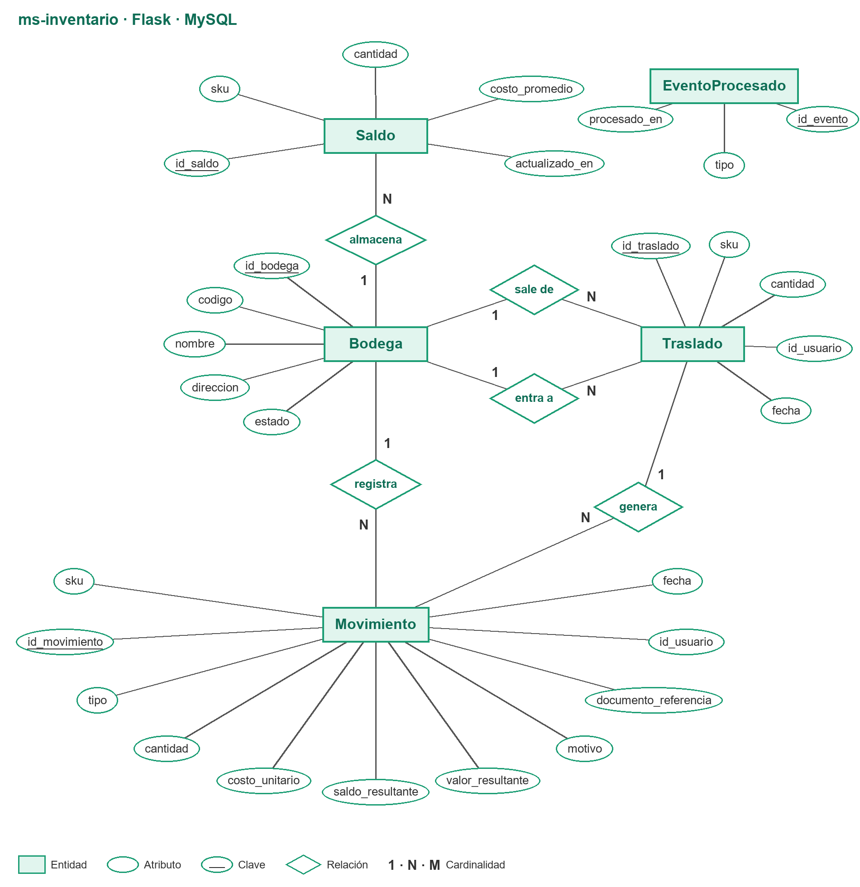
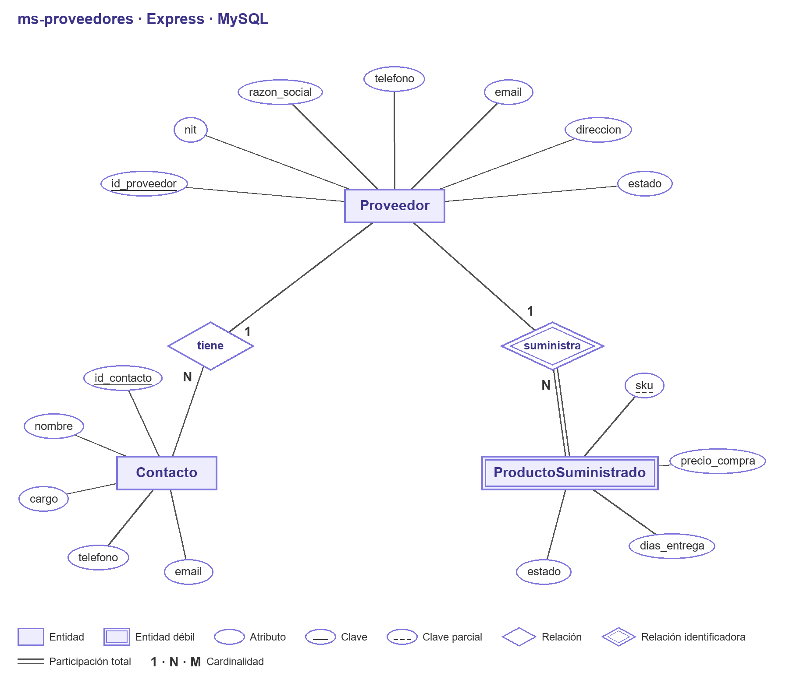
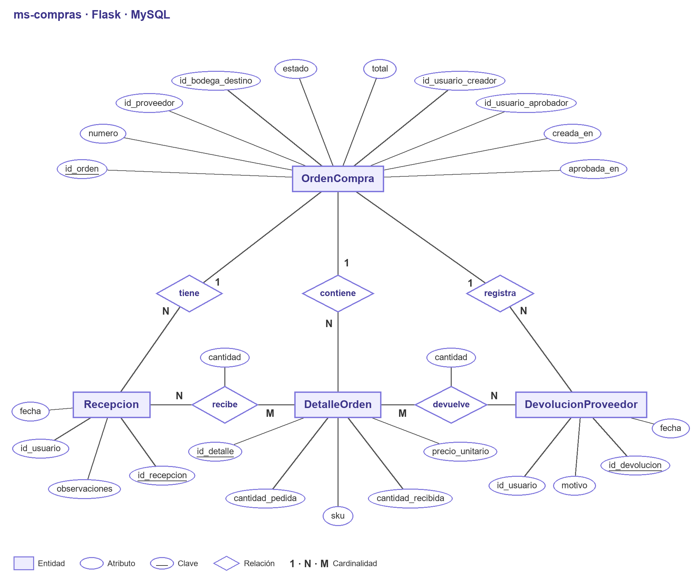
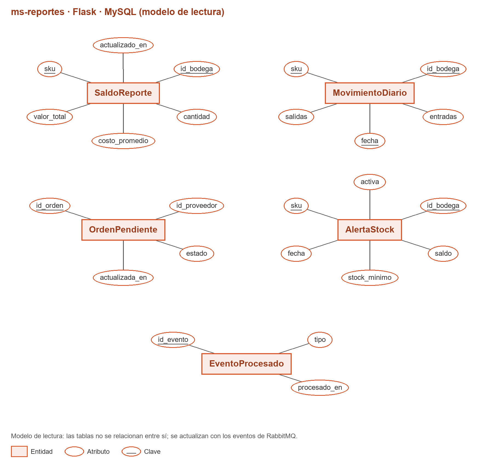
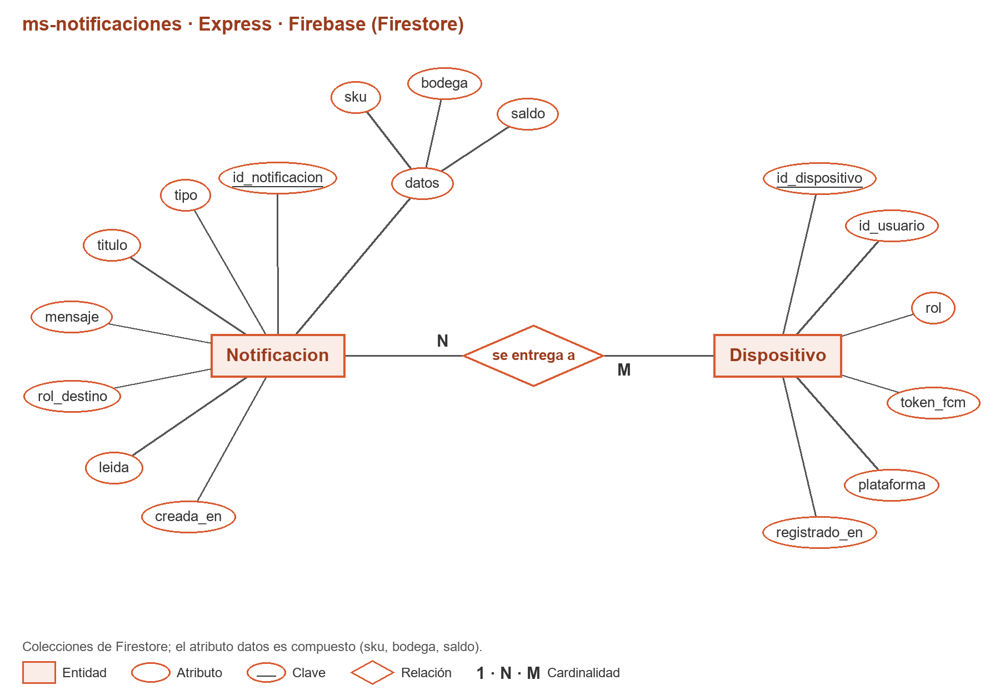

# Entrega 2 — Diseño y arquitectura (borrador)

**Proyecto:** Sistema de gestión de inventarios basado en microservicios (supermercado mediano)
**Fecha de entrega:** 26/10/2026 · sustentación oral + entrega de diagramas · 20 %
**Estado:** consolidado el 20/10/2026. El Word con la plantilla institucional está en `docs/Entrega_2_Proyecto_ISW2_Sistema_Gestion_Inventarios.docx`.

## Lista de la entrega (enunciado, sección 9)

- [x] 1. Diagrama de arquitectura de microservicios (componentes, comunicación, API Gateway propio, Service Discovery). *Aprobado el 20/10/2026.*
- [x] 2. Contratos de API por microservicio (en tablas). *Aprobados el 20/10/2026.*
- [x] 3. Modelo de datos por microservicio (diagrama entidad-relación, notación de Chen). *Aprobado el 20/10/2026.*
- [x] 4. Estrategia de contenerización y orquestación (Dockerfiles y manifiestos de Kubernetes). *Pendiente la revisión del equipo y la distribución de Kubernetes.*
- [x] 5. Plan de las 15 pruebas de rendimiento por integrante (3 bloques de 15 con Locust). *Pendiente asignar un bloque a cada integrante y elegir el entorno.*
- [x] 6. Actividad de todos los integrantes evidenciada en GitHub. *Documentados el estado actual y el plan; faltan los aportes de Daniel y Oscar.*
- [x] 7. Bitácora de uso de IA de la fase. *Consolidada la de Andrés; faltan las de Daniel y Oscar y la revisión de la reflexión.*

---

## Paso 1 — Decisiones base (20/10/2026)

### 1.1 Tecnología por microservicio

Solo se usan tecnologías vistas en clase (RNF19): Laravel, Flask, Express, MySQL y Firebase. No se usa Django.

**Regla del equipo:** Laravel se usa solo para el API Gateway; los microservicios se construyen en Flask o Express.

| Servicio | Framework | Base de datos | Justificación |
|---|---|---|---|
| API Gateway | Laravel | MySQL (usuarios, roles, tokens) | Ya existe en el repositorio; Sanctum para los tokens (RF08). Es el único componente en Laravel. |
| ms-productos | Flask | MySQL | Catálogo con CRUD y búsquedas (RF01, RF02, RF12). |
| ms-inventario | Flask | MySQL | Reglas transaccionales del saldo (no saldo negativo, RF04), kardex (RF10) y eventos con RabbitMQ. |
| ms-compras | Flask | MySQL | Ciclo de estados de la orden de compra (RF06), devoluciones a proveedor (RF13) y publicación de eventos. |
| ms-reportes | Flask | MySQL | Agregaciones, rotación y exportación a CSV/PDF (RF11, RF14). |
| ms-proveedores | Express | MySQL | Maestro de proveedores y su relación con los productos que suministran (RF03). |
| ms-notificaciones | Express | Firebase | Igual que el ejemplo de clase: envío de alertas con Firebase (RF09). |

*Ajuste del 20/10/2026:* inventario y compras pasaron de Laravel a Flask para dejar Laravel solo en el gateway.

### 1.2 Comunicación asíncrona

- **Decisión:** los eventos (`MercanciaRecibida`, `StockBajoUmbral`, eventos para reportes y la salida por devolución a proveedor) viajan por un **broker de mensajería**: RabbitMQ o Redis, a definir en el paso 2.
- **Riesgo:** el broker no se ha visto en clase y el enunciado solo permite tecnologías vistas (RNF19). **Hay que pedir autorización al docente.**
- **Plan B si no se autoriza:** tabla de eventos pendientes en MySQL dentro de cada productor, un proceso en segundo plano que los envía por HTTP con reintentos, y consumidores que ignoran eventos repetidos. El diseño de los eventos no cambia; solo cambia el canal.

### 1.3 Contratos de API

- **Decisión:** los contratos se documentan **en tablas** dentro del documento. Por cada endpoint se indica el método, la ruta, el rol autorizado, el cuerpo de entrada, la respuesta y los códigos de error.
- **Riesgo:** el enunciado pide los contratos "(OpenAPI/Swagger)". Si el docente lo exige, las tablas se pueden convertir a un `openapi.yaml` por servicio sin rediseñar nada.

---

## Paso 2 — Diagrama de arquitectura (20/10/2026)

### 2.1 Decisiones

- **Broker:** RabbitMQ, sujeto a la autorización del docente. Es mensajería de propósito general, tiene librería para los dos frameworks de los microservicios (Flask con pika y Express con amqplib; el gateway no usa RabbitMQ) y un panel web para mostrar las colas en la sustentación.
- **Convenciones de mensajería (propuesta):**
  - Un *exchange* de tipo *topic* (`inventario.eventos`). La *routing key* es el nombre del evento.
  - Una cola durable por servicio consumidor, enlazada solo a los eventos que le interesan.
  - Confirmación manual (*ack*) después de procesar el evento.
  - Colas de tipo *quorum* con un límite de 3 entregas (`x-delivery-limit`) y un *dead letter exchange* que lleva los mensajes fallidos a `q.<servicio>.errores`.
  - Todos los mensajes en JSON con el mismo sobre: `id_evento` (UUID), `tipo`, `fecha`, `productor`, `id_correlacion` y `datos`. El consumidor guarda los `id_evento` ya procesados e ignora los repetidos.
- **Descubrimiento de servicios:** cada microservicio se expone con un `Service` de Kubernetes y los demás lo llaman por su nombre DNS interno (`http://ms-productos`, `http://ms-proveedores`, etc.). Las URL se leen de variables de entorno, nunca `localhost` fijo.
- **Identidad del usuario hacia los microservicios:** el gateway valida el token de Sanctum y el rol. Luego reenvía la petición con el token de servicio (RNF10) y los encabezados `X-User-Id`, `X-User-Role` y `X-Correlation-Id`. Los servicios usan `X-User-Id` para auditar (RF10), y `X-Correlation-Id` sirve para rastrear la petición en los logs (RNF11).
- **Diagramas de la entrega:** solo el de arquitectura lógica, como imagen generada con el mismo estilo de la Entrega 1.

### 2.2 Diagrama de arquitectura lógica



### 2.3 Catálogo de eventos (preliminar)

| Evento | Productor | Consumidores | Cuándo se publica | Para qué sirve |
|---|---|---|---|---|
| `MercanciaRecibida` | ms-compras | ms-inventario | Al registrar una recepción, total o parcial, de una orden de compra. | Inventario registra la entrada (RF04, RF06). Reportes se entera por el `MovimientoRegistrado` que publica inventario. |
| `DevolucionProveedorRegistrada` | ms-compras | ms-inventario | Al registrar una devolución a proveedor. | Inventario registra la salida (RF13). |
| `OrdenCompraActualizada` | ms-compras | ms-reportes | Cada vez que una orden cambia de estado. | Órdenes pendientes en el dashboard (RF14). |
| `MovimientoRegistrado` | ms-inventario | ms-reportes | Por cada entrada, salida, ajuste o traslado. | Valorización y rotación (RF11, RF14). |
| `StockBajoUmbral` | ms-inventario | ms-notificaciones, ms-reportes | Cuando un movimiento deja el saldo en el mínimo o por debajo. | Alerta a los responsables (RF09) y productos en stock bajo (RF14). |

`MovimientoRegistrado`, `OrdenCompraActualizada` y `DevolucionProveedorRegistrada` son nuevos respecto a la Entrega 1. Los dos primeros concretan el "eventos o consulta programada" de ms-reportes; el tercero es el evento que la Entrega 1 dejó para esta entrega.

---

## Paso 3 — Modelo de datos por microservicio (propuesta, 20/10/2026)

### 3.1 Decisiones

- **Notación:** modelo entidad-relación de Chen, por confirmar:
  - Entidades en rectángulos; las entidades débiles van en doble rectángulo.
  - Atributos en óvalos, con la clave subrayada.
  - Relaciones en rombos, con su cardinalidad (1:1, 1:N, N:M).
  - Un diagrama por servicio, incluido el gateway.
- **Sin llaves foráneas entre servicios:** cada servicio guarda el identificador del otro (SKU, id_proveedor, id_bodega, id_usuario) como referencia lógica, nunca una FK.
- **Relación proveedor–producto en ms-proveedores:** entidad débil *ProductoSuministrado* (RF03). Para filtrar productos por proveedor (RF12), el gateway pide los SKU a ms-proveedores y luego consulta ms-productos.
- **Valorización por costo promedio ponderado,** por producto y bodega:
  - Cada entrada recalcula el costo con `nuevo_costo = (saldo × costo_actual + cantidad_entrada × costo_entrada) / (saldo + cantidad_entrada)`.
  - Las salidas se valoran al costo promedio vigente.
- **Tipos de dato:**
  - Cantidades `DECIMAL(14,3)`, porque hay unidades, kilos y litros.
  - Precios `DECIMAL(14,2)`.
  - Costos promedio `DECIMAL(14,4)`.
- **Stock mínimo:** vive en el producto (RF01). ms-inventario lo recibe en la respuesta de la validación síncrona del producto que hace en cada movimiento, y con eso detecta el stock bajo.

### 3.2 Entidades propuestas (la clave primaria va en negrilla)

**API Gateway (Laravel · MySQL)**

| Entidad | Atributos | Relaciones |
|---|---|---|
| Usuario | **id_usuario**, nombre, email (único), password_hash, estado, creado_en | Tiene 1 Rol (N:1); tiene N TokenAcceso (1:N). |
| Rol | **id_rol**, nombre (Administrador, Jefe de bodega, Compras, Gerente) | Agrupa N Permisos (N:M). |
| Permiso | **id_permiso**, codigo, descripcion | — |
| TokenAcceso | **id_token**, token_hash (SHA-256), nombre, habilidades, ultimo_uso, expira_en | Tabla de Sanctum (RF08, RNF08). |
| RecuperacionContrasena | **email**, token_hash, creado_en | Recuperación de contraseña (RF08). |

**ms-productos (Flask · MySQL)**

| Entidad | Atributos | Relaciones |
|---|---|---|
| Categoria | **id_categoria**, nombre, descripcion, estado | Contiene N subcategorías (1:N recursiva); clasifica N productos (1:N). |
| Producto | **id_producto**, sku (único), nombre, descripcion, marca, unidad_medida, precio_venta, stock_minimo, estado, creado_en | Pertenece a 1 categoría. |

**ms-inventario (Flask · MySQL)**

| Entidad | Atributos | Relaciones |
|---|---|---|
| Bodega | **id_bodega**, codigo (único), nombre, direccion, estado | Tiene N saldos y N movimientos (1:N). |
| Saldo | **id_saldo**, sku, cantidad, costo_promedio, actualizado_en (único por sku + bodega) | Pertenece a 1 bodega. |
| Movimiento | **id_movimiento**, sku, tipo, cantidad, costo_unitario, saldo_resultante, valor_resultante, motivo, documento_referencia, id_usuario, fecha | Ocurre en 1 bodega; es inmutable (kardex, RF10). |
| Traslado | **id_traslado**, sku, cantidad, id_usuario, fecha | Sale de 1 bodega y entra a otra (dos relaciones N:1); genera 2 movimientos. |
| EventoProcesado | **id_evento**, tipo, procesado_en | Evita procesar dos veces un evento repetido. |

Tipos de movimiento: ENTRADA_COMPRA, SALIDA, AJUSTE_POSITIVO, AJUSTE_NEGATIVO, TRASLADO_SALIDA, TRASLADO_ENTRADA, DEVOLUCION_CLIENTE y DEVOLUCION_PROVEEDOR. La devolución de cliente es un movimiento DEVOLUCION_CLIENTE cuyo documento_referencia es la factura del POS (RF13).

**ms-proveedores (Express · MySQL)**

| Entidad | Atributos | Relaciones |
|---|---|---|
| Proveedor | **id_proveedor**, nit (único), razon_social, telefono, email, direccion, estado | Tiene N contactos (1:N); suministra N productos. |
| Contacto | **id_contacto**, nombre, cargo, telefono, email | Pertenece a 1 proveedor. |
| ProductoSuministrado (débil) | sku (clave parcial), precio_compra, dias_entrega, estado | Depende de Proveedor mediante la relación identificadora *suministra*. |

**ms-compras (Flask · MySQL)**

| Entidad | Atributos | Relaciones |
|---|---|---|
| OrdenCompra | **id_orden**, numero (único), id_proveedor, id_bodega_destino, estado, total, id_usuario_creador, id_usuario_aprobador, creada_en, aprobada_en | Tiene N detalles, N recepciones y N devoluciones (1:N). |
| DetalleOrden | **id_detalle**, sku, cantidad_pedida, cantidad_recibida, precio_unitario | Pertenece a 1 orden. |
| Recepcion | **id_recepcion**, fecha, id_usuario, observaciones | De 1 orden; *recibe* N detalles (N:M con el atributo cantidad). |
| DevolucionProveedor | **id_devolucion**, fecha, motivo, id_usuario | De 1 orden; *devuelve* N detalles (N:M con el atributo cantidad). |

Estados de la orden: BORRADOR, APROBADA, RECIBIDA_PARCIAL, RECIBIDA y ANULADA (RF06).

**ms-reportes (Flask · MySQL)**: modelo de lectura que se actualiza con los eventos.

| Entidad | Atributos | Origen |
|---|---|---|
| SaldoReporte | **sku + id_bodega**, cantidad, costo_promedio, valor_total, actualizado_en | `MovimientoRegistrado` |
| MovimientoDiario | **sku + id_bodega + fecha**, entradas, salidas | `MovimientoRegistrado` (rotación) |
| OrdenPendiente | **id_orden**, id_proveedor, estado, actualizada_en | `OrdenCompraActualizada` |
| AlertaStock | **sku + id_bodega**, saldo, stock_minimo, fecha, activa | `StockBajoUmbral` |
| EventoProcesado | **id_evento**, tipo, procesado_en | Idempotencia |

Los nombres y categorías de los productos se consultan a ms-productos por REST al generar cada reporte.

**ms-notificaciones (Express · Firebase/Firestore)**

| Entidad | Atributos | Relaciones |
|---|---|---|
| Notificacion | **id_notificacion**, tipo, titulo, mensaje, rol_destino, datos (sku, bodega, saldo), leida, creada_en | Se entrega a N dispositivos (N:M). |
| Dispositivo | **id_dispositivo**, id_usuario, rol, token_fcm, plataforma, registrado_en | Cada dispositivo se suscribe al tema de su rol en Firebase. |

Las alertas de stock bajo se envían a los temas de Firebase de los roles Compras y Jefe de bodega, así que notificaciones no necesita consultar los usuarios del gateway.

### 3.3 Diagramas entidad-relación (notación de Chen)

Entidades y atributos aprobados por el equipo el 20/10/2026. Convenciones:
- Entidad: rectángulo. Entidad débil: doble rectángulo.
- Atributo: óvalo. Clave: subrayado continuo. Clave parcial: subrayado discontinuo. Atributo compuesto: óvalo con óvalos hijos.
- Relación: rombo. Relación identificadora: doble rombo.
- Participación total: doble línea.
- Cardinalidad: 1, N y M junto a cada línea.

**API Gateway**



**ms-productos**



**ms-inventario**



**ms-proveedores**



**ms-compras**



**ms-reportes**



**ms-notificaciones**



---

## Paso 4 — Contratos de API (20/10/2026)

Decisiones del equipo: contratos en tablas (no OpenAPI), rutas al estilo del ejemplo de clase (`/api/<recurso>`, sin versión), todos los endpoints con detalle y la matriz de permisos de la sección 4.3.

### 4.1 Convenciones comunes

- **Rutas:**
  - Las rutas públicas viven en el gateway con el prefijo `/api` (por ejemplo `GET /api/productos/{id}`).
  - El gateway las reenvía al servicio sin el prefijo (`GET /productos/{id}`).
  - En las tablas siguientes se muestra la ruta interna; la pública es la misma con `/api` delante.
- **Autenticación:**
  - Toda ruta pública exige `Authorization: Bearer <token de Sanctum>`, salvo `login`, `recuperar` y `restablecer`.
  - Hacia los microservicios, el gateway envía `Authorization: Bearer <token de servicio>`, `X-User-Id`, `X-User-Role` y `X-Correlation-Id`.
  - Los microservicios rechazan con 401 cualquier petición que no traiga el token de servicio, así que no se pueden llamar directamente desde fuera (RNF10).
- **Formato:**
  - JSON en UTF-8 y fechas en ISO 8601 (`2026-10-20T14:32:05Z`).
  - Cantidades con hasta 3 decimales y precios con 2.
- **Listados:** `?page=1&per_page=20` (máximo 100). La respuesta es `{"data": [...], "meta": {"page": 1, "per_page": 20, "total": 134}}`.
- **Errores:** siempre con el cuerpo `{"error": {"codigo": "STOCK_INSUFICIENTE", "mensaje": "...", "detalles": {...}}}`. Códigos HTTP:
  - 400: petición mal formada.
  - 401: sin autenticar.
  - 403: sin permiso (RNF09).
  - 404: no existe.
  - 409: conflicto (duplicado, transición de estado no permitida o saldo insuficiente).
  - 422: validación de campos.
  - 503: un servicio del que depende no responde.
- **Inactivar en vez de borrar:** los maestros se inactivan con `POST /<recurso>/{id}/inactivar` y se reactivan con `/activar`, como las acciones `bloquear`/`activar` del ejemplo de clase. Nada con historia se borra físicamente (RF01).
- **Salud:** cada servicio expone `GET /health` para las sondas de Kubernetes (RNF12). No pasa por el gateway.

### 4.2 Enrutamiento del gateway

| Prefijo público | Destino | Ruta interna |
|---|---|---|
| `/api/auth/*`, `/api/usuarios/*`, `/api/roles` | API Gateway (se atiende en el propio gateway) | — |
| `/api/categorias/*`, `/api/productos/*` | ms-productos | `/categorias/*`, `/productos/*` |
| `/api/bodegas/*`, `/api/stock/*`, `/api/movimientos/*`, `/api/kardex`, `/api/traslados/*`, `/api/devoluciones-cliente/*` | ms-inventario | igual, sin `/api` |
| `/api/proveedores/*` | ms-proveedores | `/proveedores/*` |
| `/api/ordenes-compra/*`, `/api/devoluciones-proveedor` | ms-compras | igual, sin `/api` |
| `/api/reportes/*`, `/api/dashboard` | ms-reportes | igual, sin `/api` |
| `/api/notificaciones/*`, `/api/dispositivos/*` | ms-notificaciones | igual, sin `/api` |

**Única composición en el gateway:** `GET /api/productos?id_proveedor={id}` (filtrar productos por proveedor, RF12). El gateway pide los SKU a `GET /proveedores/{id}/productos` y luego consulta `GET /productos?skus=...`.

### 4.3 Matriz de permisos por rol (aprobada)

| Operación | Administrador | Jefe de bodega | Compras | Gerente |
|---|---|---|---|---|
| Usuarios y roles | Sí | — | — | — |
| Productos y categorías | Sí | Ver | Ver | Ver |
| Bodegas | Sí | Sí | Ver | Ver |
| Consultar saldos (stock) | Sí | Sí | Sí | Sí |
| Movimientos, ajustes y traslados | Sí | Sí | — | Ver |
| Devolución de cliente | Sí | Sí | — | Ver |
| Proveedores y sus productos | Sí | Ver | Sí | Ver |
| Crear y editar órdenes de compra | Sí | Ver | Sí | Ver |
| Aprobar y anular órdenes | Sí | — | — | Sí |
| Recibir mercancía | Sí | Sí | — | — |
| Devolución a proveedor | Sí | Sí | Sí | — |
| Reportes y dashboard | Sí | Sí | Sí | Sí |

*Ver* = solo consulta (GET). Se agregaron dos precisiones necesarias para operar: todos los roles pueden consultar saldos, y el Jefe de bodega puede ver las órdenes de compra para recibirlas.

### 4.4 API Gateway (Laravel)

| Método | Ruta pública | Roles | Entrada | Respuesta | Errores |
|---|---|---|---|---|---|
| POST | `/api/auth/login` | Público | `{email, password}` | 200 `{token, usuario: {id, nombre, email, rol}}` | 401 credenciales inválidas; 403 usuario inactivo; 422 |
| POST | `/api/auth/logout` | Autenticado | — | 204; revoca el token (RF08) | 401 |
| GET | `/api/auth/me` | Autenticado | — | 200 usuario con rol y permisos | 401 |
| PUT | `/api/auth/password` | Autenticado | `{password_actual, password_nueva}` | 204 | 401; 422 |
| POST | `/api/auth/password/recuperar` | Público | `{email}` | 202 siempre (no revela si el correo existe); envía un enlace con token | 422 |
| POST | `/api/auth/password/restablecer` | Público | `{email, token, password_nueva}` | 204 | 422 token inválido o vencido |
| GET | `/api/usuarios` | Admin | `?rol&estado&page&per_page` | 200 listado | 403 |
| POST | `/api/usuarios` | Admin | `{nombre, email, password, id_rol}` | 201 usuario | 409 email duplicado; 422 |
| GET | `/api/usuarios/{id}` | Admin | — | 200 usuario | 404 |
| PUT | `/api/usuarios/{id}` | Admin | `{nombre, email, id_rol}` | 200 usuario | 404; 409; 422 |
| POST | `/api/usuarios/{id}/inactivar` | Admin | — | 200; revoca sus tokens | 404 |
| POST | `/api/usuarios/{id}/activar` | Admin | — | 200 | 404 |
| GET | `/api/roles` | Admin | — | 200 roles con sus permisos | 403 |

### 4.5 ms-productos (Flask)

| Método | Ruta interna | Roles | Entrada | Respuesta | Errores |
|---|---|---|---|---|---|
| GET | `/categorias` | Todos | `?estado&id_padre` | 200 listado (con subcategorías) | — |
| GET | `/categorias/{id}` | Todos | — | 200 categoría | 404 |
| POST | `/categorias` | Admin | `{nombre, descripcion, id_categoria_padre?}` | 201 categoría | 409 nombre repetido en el mismo nivel; 422 |
| PUT | `/categorias/{id}` | Admin | `{nombre, descripcion, id_categoria_padre?}` | 200 categoría | 404; 409; 422 |
| POST | `/categorias/{id}/inactivar` | Admin | — | 200 | 409 `CATEGORIA_CON_PRODUCTOS` (RF02) |
| POST | `/categorias/{id}/activar` | Admin | — | 200 | 404 |
| GET | `/productos` | Todos | `?q` (SKU o nombre)`&id_categoria&estado&precio_min&precio_max&skus&page&per_page` | 200 listado paginado (RF12) | 422 filtros inválidos |
| GET | `/productos/{id}` | Todos | — | 200 producto | 404 |
| GET | `/productos/sku/{sku}` | Todos e interno | — | 200 `{sku, nombre, estado, unidad_medida, stock_minimo, id_categoria}` | 404 |
| POST | `/productos` | Admin | `{sku, nombre, descripcion, marca, id_categoria, unidad_medida, precio_venta, stock_minimo}` | 201 producto | 409 `SKU_DUPLICADO`; 422 categoría inexistente o inactiva |
| PUT | `/productos/{id}` | Admin | igual que POST, sin `sku` | 200 producto | 404; 422 |
| POST | `/productos/{id}/inactivar` | Admin | — | 200 | 404 |
| POST | `/productos/{id}/activar` | Admin | — | 200 | 404 |

`GET /productos/sku/{sku}` es la consulta síncrona que hace ms-inventario antes de cada movimiento; de ahí obtiene el `stock_minimo`.

### 4.6 ms-inventario (Flask)

| Método | Ruta interna | Roles | Entrada | Respuesta | Errores |
|---|---|---|---|---|---|
| GET | `/bodegas` | Todos | `?estado` | 200 listado | — |
| GET | `/bodegas/{id}` | Todos | — | 200 bodega | 404 |
| POST | `/bodegas` | Admin, Jefe | `{codigo, nombre, direccion}` | 201 bodega | 409 código duplicado; 422 |
| PUT | `/bodegas/{id}` | Admin, Jefe | `{nombre, direccion}` | 200 bodega | 404; 422 |
| POST | `/bodegas/{id}/inactivar` y `/activar` | Admin, Jefe | — | 200 | 404 |
| GET | `/stock` | Todos | `?sku&id_bodega&bajo_minimo=true&page` | 200 saldos por producto y bodega | — |
| GET | `/stock/{sku}` | Todos | — | 200 `{sku, por_bodega: [{id_bodega, cantidad, costo_promedio, valor}], total}` (RF05) | 404 |
| POST | `/movimientos` | Admin, Jefe | `{sku, id_bodega, tipo, cantidad, costo_unitario?, motivo, documento_referencia?}`; tipo SALIDA, AJUSTE_POSITIVO o AJUSTE_NEGATIVO | 201 movimiento con `saldo_resultante` y `valor_resultante`; publica `MovimientoRegistrado` y, si corresponde, `StockBajoUmbral` | 409 `STOCK_INSUFICIENTE` (RF04); 422 motivo obligatorio en ajustes; 404 producto inexistente; 503 ms-productos no responde |
| GET | `/movimientos` | Admin, Jefe, Gerente | `?sku&id_bodega&tipo&desde&hasta&page` | 200 listado paginado | 422 |
| GET | `/movimientos/{id}` | Admin, Jefe, Gerente | — | 200 movimiento | 404 |
| GET | `/kardex` | Admin, Jefe, Gerente | `?sku&id_bodega&desde&hasta` (obligatorios) | 200 `{saldo_inicial, movimientos: [...], saldo_final}` en cantidad y valor (RF10) | 422 |
| POST | `/traslados` | Admin, Jefe | `{sku, id_bodega_origen, id_bodega_destino, cantidad, motivo?}` | 201 traslado con sus 2 movimientos | 409 `STOCK_INSUFICIENTE`; 422 bodegas iguales o inactivas |
| GET | `/traslados` y `/traslados/{id}` | Admin, Jefe, Gerente | `?sku&desde&hasta&page` | 200 | 404 |
| POST | `/devoluciones-cliente` | Admin, Jefe | `{sku, id_bodega, cantidad, factura_pos, motivo}` | 201 movimiento DEVOLUCION_CLIENTE (RF13) | 422 |
| GET | `/devoluciones-cliente` | Admin, Jefe, Gerente | `?sku&desde&hasta&page` | 200 listado | — |

Las entradas por compra y las salidas por devolución a proveedor no tienen endpoint: llegan por los eventos `MercanciaRecibida` y `DevolucionProveedorRegistrada`. El inventario inicial se carga con ajustes positivos con motivo "inventario inicial".

### 4.7 ms-proveedores (Express)

| Método | Ruta interna | Roles | Entrada | Respuesta | Errores |
|---|---|---|---|---|---|
| GET | `/proveedores` | Todos | `?q` (NIT o razón social)`&estado&sku&page` | 200 listado paginado | — |
| GET | `/proveedores/{id}` | Todos e interno | — | 200 proveedor con contactos | 404 |
| POST | `/proveedores` | Admin, Compras | `{nit, razon_social, telefono, email, direccion}` | 201 proveedor | 409 `NIT_DUPLICADO`; 422 |
| PUT | `/proveedores/{id}` | Admin, Compras | igual que POST, sin `nit` | 200 proveedor | 404; 422 |
| POST | `/proveedores/{id}/inactivar` y `/activar` | Admin, Compras | — | 200 | 404 |
| POST | `/proveedores/{id}/contactos` | Admin, Compras | `{nombre, cargo, telefono, email}` | 201 contacto | 404; 422 |
| PUT | `/proveedores/{id}/contactos/{id_contacto}` | Admin, Compras | igual | 200 contacto | 404; 422 |
| DELETE | `/proveedores/{id}/contactos/{id_contacto}` | Admin, Compras | — | 204 | 404 |
| GET | `/proveedores/{id}/productos` | Todos e interno | — | 200 `[{sku, precio_compra, dias_entrega, estado}]` | 404 |
| PUT | `/proveedores/{id}/productos/{sku}` | Admin, Compras | `{precio_compra, dias_entrega}` | 200; crea o actualiza la relación (RF03) | 404; 422 |
| DELETE | `/proveedores/{id}/productos/{sku}` | Admin, Compras | — | 204 | 404 |

`GET /proveedores/{id}` es la consulta síncrona que hace ms-compras para validar que el proveedor exista y esté activo.

### 4.8 ms-compras (Flask)

| Método | Ruta interna | Roles | Entrada | Respuesta | Errores |
|---|---|---|---|---|---|
| GET | `/ordenes-compra` | Todos | `?estado&id_proveedor&desde&hasta&page` | 200 listado paginado | — |
| GET | `/ordenes-compra/{id}` | Todos | — | 200 orden con detalle, recepciones y devoluciones | 404 |
| POST | `/ordenes-compra` | Admin, Compras | `{id_proveedor, id_bodega_destino, items: [{sku, cantidad, precio_unitario}]}` | 201 orden en BORRADOR; publica `OrdenCompraActualizada` | 422 proveedor inexistente o inactivo (RF03) o sin ítems; 503 ms-proveedores no responde |
| PUT | `/ordenes-compra/{id}` | Admin, Compras | igual que POST | 200 orden | 409 `ESTADO_NO_EDITABLE` (solo en BORRADOR); 422 |
| POST | `/ordenes-compra/{id}/aprobar` | Admin, Gerente | — | 200 orden APROBADA; publica `OrdenCompraActualizada` | 409 `TRANSICION_INVALIDA` |
| POST | `/ordenes-compra/{id}/anular` | Admin, Gerente | `{motivo}` | 200 orden ANULADA; publica `OrdenCompraActualizada` | 409 si ya tiene recepciones |
| POST | `/ordenes-compra/{id}/recepciones` | Admin, Jefe | `{items: [{id_detalle, cantidad}], observaciones}` | 201 recepción; la orden pasa a RECIBIDA_PARCIAL o RECIBIDA; publica `MercanciaRecibida` y `OrdenCompraActualizada` | 409 orden no aprobada o cantidad mayor que la pendiente; 422 |
| GET | `/ordenes-compra/{id}/recepciones` | Todos | — | 200 listado | 404 |
| POST | `/ordenes-compra/{id}/devoluciones` | Admin, Jefe, Compras | `{items: [{id_detalle, cantidad}], motivo}` | 201 devolución; publica `DevolucionProveedorRegistrada` (RF13) | 409 cantidad mayor que la recibida; 422 |
| GET | `/devoluciones-proveedor` | Admin, Jefe, Compras | `?id_proveedor&desde&hasta&page` | 200 listado | — |

Transiciones permitidas: BORRADOR → APROBADA o ANULADA; APROBADA → RECIBIDA_PARCIAL, RECIBIDA o ANULADA (solo sin recepciones); RECIBIDA_PARCIAL → RECIBIDA.

### 4.9 ms-reportes (Flask)

| Método | Ruta interna | Roles | Entrada | Respuesta | Errores |
|---|---|---|---|---|---|
| GET | `/reportes/valorizacion` | Todos | `?agrupar=producto,categoria,bodega&id_bodega&formato=json,csv,pdf` | 200 reporte en el formato pedido (RF11) | 422 |
| GET | `/reportes/rotacion` | Todos | `?desde&hasta&id_bodega&top=10&formato=json,csv,pdf` | 200 productos de mayor y menor rotación (RF11) | 422 |
| GET | `/reportes/stock-bajo` | Todos | `?id_bodega` | 200 alertas activas | — |
| GET | `/dashboard` | Todos | — | 200 `{valor_total_inventario, productos_stock_bajo, ordenes_pendientes, mayor_rotacion, menor_rotacion}` (RF14) | — |

Los nombres y categorías de los productos se consultan a `GET /productos` de ms-productos al armar cada reporte. El bloque de movimientos recientes del dashboard lo obtiene el frontend directamente de `GET /api/movimientos?per_page=10`.

### 4.10 ms-notificaciones (Express + Firebase)

| Método | Ruta interna | Roles | Entrada | Respuesta | Errores |
|---|---|---|---|---|---|
| POST | `/dispositivos` | Todos | `{token_fcm, plataforma}` (el usuario y el rol llegan en los encabezados) | 201 dispositivo; lo suscribe al tema de Firebase de su rol | 422 |
| DELETE | `/dispositivos/{id}` | Dueño o Admin | — | 204 | 404 |
| GET | `/notificaciones` | Todos | `?leida&page` (filtra por el rol del usuario) | 200 listado | — |
| POST | `/notificaciones/{id}/leida` | Todos | — | 200 | 404 |

Las notificaciones no se crean por HTTP: nacen del evento `StockBajoUmbral` y se envían a los temas de los roles Compras y Jefe de bodega.

### 4.11 Formato de los eventos (RabbitMQ)

Todos los eventos usan el mismo sobre:

```json
{
  "id_evento": "6f1c2a9e-1b7d-4c55-9a51-3f0e8d2b7c10",
  "tipo": "MercanciaRecibida",
  "fecha": "2026-10-20T14:32:05Z",
  "productor": "ms-compras",
  "id_correlacion": "c1f4b8e2-77a0-4d1e-9a3b-0c5d6e7f8a90",
  "datos": { }
}
```

| Evento | Campos de `datos` | Cola que lo recibe |
|---|---|---|
| `MercanciaRecibida` | `id_orden, id_recepcion, id_bodega, id_usuario, items: [{sku, cantidad, costo_unitario}]` | `q.inventario` |
| `DevolucionProveedorRegistrada` | `id_orden, id_devolucion, id_bodega, id_usuario, motivo, items: [{sku, cantidad}]` | `q.inventario` |
| `OrdenCompraActualizada` | `id_orden, numero, id_proveedor, estado, total` | `q.reportes` |
| `MovimientoRegistrado` | `id_movimiento, sku, id_bodega, tipo, cantidad, costo_unitario, saldo_resultante, costo_promedio, valor_resultante` | `q.reportes` |
| `StockBajoUmbral` | `sku, id_bodega, saldo, stock_minimo` | `q.notificaciones`, `q.reportes` |

**Manejo de fallos:**
- El consumidor confirma (*ack*) solo después de guardar el cambio y el `id_evento` en `EventoProcesado`; si el evento ya estaba procesado, lo descarta.
- Si falla, el consumidor lo rechaza y RabbitMQ lo vuelve a entregar. Al superar el límite de 3 entregas de la cola *quorum*, el *dead letter exchange* lo lleva a la cola de errores (`q.<servicio>.errores`) para revisión manual.
- Un caso conocido termina ahí: una devolución a proveedor que ya no tiene saldo suficiente en inventario.

---

## Paso 5 — Contenerización y orquestación (20/10/2026)

### 5.1 Decisiones

- **Docker:** una imagen por componente (RNF04). Docker Compose solo se usa en desarrollo local.
- **Kubernetes:**
  - La distribución está **por definir** (Minikube, Docker Desktop o kind).
  - Los manifiestos usan solo objetos estándar (Deployment, StatefulSet, Service, ConfigMap, Secret, PersistentVolumeClaim, HorizontalPodAutoscaler) para que funcionen en cualquiera.
- **Bases de datos:** un MySQL por servicio, como StatefulSet con volumen propio (RNF02). Son 6 instancias: gateway, productos, inventario, proveedores, compras y reportes. Notificaciones usa Firebase, que está fuera del clúster.
- **Exposición, por ahora en puertos locales:**
  - En Docker Compose cada servicio se publica en un puerto de `localhost`.
  - En Kubernetes solo el gateway se expone con un Service `NodePort` (puerto 30080) o con `kubectl port-forward`. Los microservicios quedan como `ClusterIP`, sin acceso externo (RNF10).
  - Más adelante se puede reemplazar por un Ingress.
- **Consumidores de eventos:**
  - En los servicios Flask el consumidor de RabbitMQ corre como un proceso aparte. Usa la misma imagen con otro comando, en su propio Deployment (`ms-inventario-consumidor`, `ms-reportes-consumidor`), y así se escala por separado.
  - En ms-notificaciones (Express) el consumidor corre en el mismo proceso.

### 5.2 Imágenes Docker

| Componente | Imagen base | Servidor | Puerto del contenedor |
|---|---|---|---|
| API Gateway | `php:8.3-apache` (versión según el `composer.json` del gateway) | Apache con `public/` como raíz | 80 |
| ms-productos, ms-inventario, ms-compras, ms-reportes | `python:3.12-slim` | Gunicorn (servidor WSGI de producción para Flask) | 5000 |
| ms-proveedores, ms-notificaciones | `node:24-alpine` | Node | 3000 |
| Bases de datos | `mysql:8.4` | — | 3306 |
| Broker | `rabbitmq:4-management` | — | 5672 (AMQP) y 15672 (panel) |

*Ajuste del 20/10/2026:* Node.js 20 y MySQL 8.0 llegaron al final de su soporte en 2026, y RabbitMQ 3 ya no figura entre las imágenes con soporte; por eso se usan Node.js 24, MySQL 8.4 (versión con soporte extendido) y RabbitMQ 4.

Reglas comunes:
- Usuario no root.
- Archivo `.dockerignore`.
- Dependencias instaladas antes de copiar el código, para aprovechar la caché.
- Configuración por variables de entorno.
- Ningún secreto dentro de la imagen (RNF08).
- Etiquetas con versión (`ms-inventario:1.0.0`), nunca solo `latest`.

**Dockerfile de ejemplo, servicio Flask:**

```dockerfile
FROM python:3.12-slim
WORKDIR /app
ENV PYTHONDONTWRITEBYTECODE=1 PYTHONUNBUFFERED=1
COPY requirements.txt .
RUN pip install --no-cache-dir -r requirements.txt
COPY . .
RUN useradd --create-home appuser
USER appuser
EXPOSE 5000
CMD ["gunicorn", "--bind", "0.0.0.0:5000", "--workers", "3", "app:app"]
```

**Dockerfile de ejemplo, servicio Express:**

```dockerfile
FROM node:24-alpine
WORKDIR /app
ENV NODE_ENV=production
COPY package*.json ./
RUN npm ci --omit=dev
COPY . .
USER node
EXPOSE 3000
CMD ["node", "src/server.js"]
```

**Dockerfile de ejemplo, API Gateway (Laravel, en dos etapas):**

```dockerfile
FROM composer:2 AS vendor
WORKDIR /app
COPY composer.json composer.lock ./
RUN composer install --no-dev --no-scripts --prefer-dist --no-interaction
COPY . .
RUN composer dump-autoload --optimize

FROM php:8.3-apache
RUN docker-php-ext-install pdo_mysql && a2enmod rewrite
ENV APACHE_DOCUMENT_ROOT=/var/www/html/public
RUN sed -ri 's!/var/www/html!${APACHE_DOCUMENT_ROOT}!g' /etc/apache2/sites-available/*.conf
WORKDIR /var/www/html
COPY --from=vendor /app .
RUN chown -R www-data:www-data storage bootstrap/cache
EXPOSE 80
```

### 5.3 Docker Compose (desarrollo local)

| Contenedor | Puerto en `localhost` | Notas |
|---|---|---|
| api-gateway | 8000 | Único punto de entrada para el frontend. |
| ms-productos | 5001 | Expuesto solo en desarrollo, para depurar. |
| ms-inventario | 5002 | Ídem. |
| ms-compras | 5003 | Ídem. |
| ms-reportes | 5004 | Ídem. |
| ms-proveedores | 3001 | Ídem. |
| ms-notificaciones | 3002 | Ídem. |
| mysql-gateway … mysql-reportes | 33061 a 33066 | Uno por servicio, para conectarse con un cliente SQL. |
| rabbitmq | 5672 y 15672 | 15672 es el panel web de administración. |

### 5.4 Objetos de Kubernetes

Todo vive en el namespace `inventario`.

| Componente | Objetos |
|---|---|
| API Gateway | Deployment (2 réplicas) + Service `NodePort` 30080 + ConfigMap (URL de cada servicio) + Secret (APP_KEY, token de servicio, contraseña de BD) + HPA |
| ms-productos, ms-proveedores, ms-compras, ms-reportes, ms-notificaciones | Deployment + Service `ClusterIP` (puerto 80) + ConfigMap + Secret |
| ms-inventario | Igual que los anteriores + HPA (2 a 5 réplicas, CPU 70 %) para el escalado independiente (RNF05) |
| Consumidores Flask | Deployments `ms-inventario-consumidor` y `ms-reportes-consumidor` (misma imagen, comando del consumidor) |
| MySQL (×6) | StatefulSet + Service sin IP de clúster (*headless*) + PersistentVolumeClaim de 1 GiB + Secret |
| RabbitMQ | StatefulSet + Service (5672) + PersistentVolumeClaim; el panel 15672 se abre con `kubectl port-forward` |

Todos los Deployments llevan:
- Sondas `readinessProbe` y `livenessProbe` sobre `GET /health` (RNF12).
- `requests` y `limits` de CPU y memoria.
- La configuración desde ConfigMap y Secret (RNF08).

Las URL entre servicios usan el DNS interno (`http://ms-productos`), sin `localhost`.

**Manifiestos de ejemplo, ms-inventario:**

```yaml
apiVersion: apps/v1
kind: Deployment
metadata:
  name: ms-inventario
  namespace: inventario
spec:
  replicas: 2
  selector:
    matchLabels: {app: ms-inventario}
  template:
    metadata:
      labels: {app: ms-inventario}
    spec:
      containers:
        - name: ms-inventario
          image: <usuario>/ms-inventario:1.0.0
          ports: [{containerPort: 5000}]
          envFrom:
            - configMapRef: {name: ms-inventario-config}
            - secretRef: {name: ms-inventario-secret}
          readinessProbe:
            httpGet: {path: /health, port: 5000}
            initialDelaySeconds: 5
          livenessProbe:
            httpGet: {path: /health, port: 5000}
            initialDelaySeconds: 15
          resources:
            requests: {cpu: 100m, memory: 128Mi}
            limits: {cpu: 500m, memory: 256Mi}
---
apiVersion: v1
kind: Service
metadata: {name: ms-inventario, namespace: inventario}
spec:
  selector: {app: ms-inventario}
  ports: [{port: 80, targetPort: 5000}]
---
apiVersion: v1
kind: ConfigMap
metadata: {name: ms-inventario-config, namespace: inventario}
data:
  DB_HOST: mysql-inventario
  DB_NAME: inventario
  PRODUCTOS_URL: http://ms-productos
  RABBITMQ_HOST: rabbitmq
---
apiVersion: autoscaling/v2
kind: HorizontalPodAutoscaler
metadata: {name: ms-inventario, namespace: inventario}
spec:
  scaleTargetRef: {apiVersion: apps/v1, kind: Deployment, name: ms-inventario}
  minReplicas: 2
  maxReplicas: 5
  metrics:
    - type: Resource
      resource: {name: cpu, target: {type: Utilization, averageUtilization: 70}}
```

**Manifiesto de ejemplo, MySQL de ms-inventario:**

```yaml
apiVersion: apps/v1
kind: StatefulSet
metadata: {name: mysql-inventario, namespace: inventario}
spec:
  serviceName: mysql-inventario
  replicas: 1
  selector:
    matchLabels: {app: mysql-inventario}
  template:
    metadata:
      labels: {app: mysql-inventario}
    spec:
      containers:
        - name: mysql
          image: mysql:8.4
          args: ["--innodb-buffer-pool-size=64M"]
          ports: [{containerPort: 3306}]
          env:
            - {name: MYSQL_DATABASE, value: inventario}
            - name: MYSQL_ROOT_PASSWORD
              valueFrom: {secretKeyRef: {name: mysql-inventario-secret, key: root-password}}
          volumeMounts: [{name: datos, mountPath: /var/lib/mysql}]
  volumeClaimTemplates:
    - metadata: {name: datos}
      spec:
        accessModes: [ReadWriteOnce]
        resources: {requests: {storage: 1Gi}}
---
apiVersion: v1
kind: Service
metadata: {name: mysql-inventario, namespace: inventario}
spec:
  clusterIP: None
  selector: {app: mysql-inventario}
  ports: [{port: 3306}]
```

**Service del gateway en puertos locales:**

```yaml
apiVersion: v1
kind: Service
metadata: {name: api-gateway, namespace: inventario}
spec:
  type: NodePort
  selector: {app: api-gateway}
  ports: [{port: 80, targetPort: 80, nodePort: 30080}]
```

También funciona en cualquier distribución con `kubectl port-forward -n inventario svc/api-gateway 8000:80`, y el gateway queda en `http://localhost:8000`.

**Estructura de carpetas propuesta en el repositorio:**

```
docker-compose.yml
k8s/
  namespace.yaml
  gateway/          deployment.yaml, service.yaml, configmap.yaml, secret.example.yaml, hpa.yaml
  ms-<servicio>/    deployment.yaml, service.yaml, configmap.yaml, secret.example.yaml
  mysql/            mysql-<servicio>.yaml (uno por servicio)
  rabbitmq/         statefulset.yaml, service.yaml
```

Los Secret reales no se suben al repositorio; solo se versionan los `secret.example.yaml` con valores de ejemplo.

**Recursos estimados:** 6 MySQL (con el buffer de InnoDB reducido a 64 MB) + RabbitMQ + 7 servicios + 2 consumidores suman unos 4 GB de RAM. Conviene asignar al menos 6 GB al clúster local. El HPA necesita *metrics-server*, que se instala según la distribución elegida.

---

## Paso 6 — Plan de pruebas de rendimiento (20/10/2026)

### 6.1 Decisiones

- **Herramienta:** Locust. Las pruebas se escriben en Python y se ejecutan sin interfaz (`--headless`), exportando resultados en CSV y HTML (`--csv`, `--html`) para versionarlos en GitHub.
- **Carga de referencia para RNF07:**
  - Normal: 20 usuarios concurrentes.
  - Pico: 50.
  - Estrés: hasta 200 o hasta que el sistema falle.
  - Justificación: un supermercado mediano tiene pocos usuarios internos simultáneos (bodega, compras y gerencia); el pico representa el cierre de mes o una jornada de recepciones masivas.
- **Responsables:** por definir. Las 45 pruebas se organizan en 3 bloques de 15 (A, B y C) y cada integrante tomará un bloque. Cada bloque cubre al menos tres microservicios y los tres escenarios.
- **Entorno:** por decidir (Docker Compose o Kubernetes local). Las mediciones "antes" y "después" de las optimizaciones de la Entrega 4 deben hacerse en el mismo entorno.
- **Todas las peticiones pasan por el API Gateway,** porque así se mide el sistema como lo usaría el cliente.

### 6.2 Escenarios

| Escenario | Usuarios | Arranque | Duración | Pausa entre peticiones | Objetivo |
|---|---|---|---|---|---|
| Normal (N) | 20 | 5 usuarios/s | 5 min | 1 a 3 s | Verificar RNF07 en operación diaria. |
| Pico (P) | 50 | 10 usuarios/s | 5 min | 1 a 3 s | Verificar RNF07 en el momento de mayor demanda. |
| Estrés (E) | De 20 a 200, sumando 20 cada 30 s (`LoadTestShape`) | — | Hasta llegar a 200 o a más de 5 % de errores | 0,5 a 1,5 s | Encontrar el punto de quiebre: con cuántos usuarios el p95 supera 2 s o aparecen errores. |

**Métricas de cada prueba:**
- Tiempo de respuesta p50, p95 y p99.
- Peticiones por segundo (*throughput*).
- Tasa de errores.
- En estrés, además, el número de usuarios en el punto de quiebre.

**Criterio de aprobación (escenarios N y P):** p95 menor a 2 s (RNF07) y menos de 1 % de errores.

### 6.3 Catálogo de pruebas

Cada endpoint se prueba en los tres escenarios. Por ejemplo, la prueba A2 genera las pruebas A2-N, A2-P y A2-E: 15 endpoints × 3 escenarios = 45 pruebas.

**Bloque A: autenticación, catálogo y proveedores**

| ID | Endpoint (vía gateway) | Servicios involucrados | Tipo | Qué se observa en particular |
|---|---|---|---|---|
| A1 | `POST /api/auth/login` | Gateway | Escritura | Costo del hash de contraseñas y la emisión de tokens. |
| A2 | `GET /api/productos?q=leche&page=1` | Gateway, ms-productos | Lectura | Búsqueda por nombre o SKU sobre 2.000 productos (RF12). |
| A3 | `GET /api/productos/{id}` | Gateway, ms-productos | Lectura | Línea base de una consulta simple. |
| A4 | `GET /api/proveedores?q=...` | Gateway, ms-proveedores | Lectura | Rendimiento de Express con MySQL. |
| A5 | `GET /api/productos?id_proveedor={id}` | Gateway, ms-proveedores, ms-productos | Lectura | Costo de la composición en el gateway (dos llamadas). |

**Bloque B: inventario**

| ID | Endpoint (vía gateway) | Servicios involucrados | Tipo | Qué se observa en particular |
|---|---|---|---|---|
| B1 | `GET /api/stock/{sku}` | Gateway, ms-inventario | Lectura | Consolidado por bodega (RF05). |
| B2 | `GET /api/stock?bajo_minimo=true` | Gateway, ms-inventario | Lectura | Consulta con filtro sobre todos los saldos. |
| B3 | `POST /api/movimientos` (SALIDA) | Gateway, ms-inventario, ms-productos, RabbitMQ | Escritura | Validación síncrona del producto, bloqueo del saldo y publicación de eventos. |
| B4 | `POST /api/traslados` | Gateway, ms-inventario, RabbitMQ | Escritura | Dos movimientos en una sola transacción. |
| B5 | `GET /api/kardex?sku&id_bodega&desde&hasta` | Gateway, ms-inventario | Lectura | Consulta histórica con muchos movimientos (RF10). |

**Bloque C: compras, reportes y flujo completo**

| ID | Endpoint (vía gateway) | Servicios involucrados | Tipo | Qué se observa en particular |
|---|---|---|---|---|
| C1 | `POST /api/ordenes-compra` | Gateway, ms-compras, ms-proveedores | Escritura | Validación síncrona del proveedor. |
| C2 | `POST /api/ordenes-compra/{id}/recepciones` | Gateway, ms-compras, RabbitMQ, ms-inventario | Escritura | Además de la respuesta, el tiempo hasta que el stock se actualiza (consistencia eventual, RNF13), medido consultando `GET /api/stock/{sku}`. |
| C3 | `GET /api/dashboard` | Gateway, ms-reportes | Lectura | Indicadores agregados (RF14). |
| C4 | `GET /api/reportes/valorizacion?agrupar=categoria` | Gateway, ms-reportes, ms-productos | Lectura | Agregación más consulta del catálogo (RF11). |
| C5 | `GET /api/reportes/rotacion?desde&hasta&formato=csv` | Gateway, ms-reportes | Lectura | Generación y descarga de un archivo. |

### 6.4 Preparación y registro

- **Datos de prueba**, cargados con un script antes de cada corrida:
  - 2.000 productos en 20 categorías.
  - 3 bodegas con saldo inicial.
  - 50 proveedores con sus productos suministrados.
  - Órdenes aprobadas para las pruebas de recepción.
  - Un usuario por rol.
- **Autenticación:** cada usuario virtual inicia sesión una sola vez al arrancar (`on_start`) y reutiliza su token. La excepción es A1, que mide justamente el login.
- **Repeticiones:** cada prueba se ejecuta 3 veces y se reporta la mediana.
- **Registro de resultados:** una tabla por prueba con fecha, versión de las imágenes, entorno, usuarios, peticiones por segundo, p50, p95, p99, % de errores y observaciones.
- **En el repositorio:**
  - `pruebas/locust/bloque_a.py`, `bloque_b.py` y `bloque_c.py`.
  - Los resultados en `pruebas/resultados/<ID>/`.

---

## Paso 7 — GitHub, bitácora y documento final (20/10/2026)

Decisiones del equipo: la sección de GitHub muestra el estado actual y un plan; las bitácoras de Daniel y Oscar aún no tienen registros de esta fase; la IA redacta un borrador de la reflexión para revisión del equipo, y se genera el Word.

### 7.1 Actividad en GitHub (al 20/10/2026)

| Integrante | Rama | Commits | Pull requests | Observaciones |
|---|---|---|---|---|
| Andrés Hernández | `andres` | 27/09: README con integrantes y documentos. 19/10: rectificación de la Entrega 1. | #1 `andres` → `develop`, fusionado el 19/10/2026 | Dos nombres de autor (Andres Hernandez y hernandez2404) con el mismo correo. |
| Oscar David Gomez Mosquera | `oscar` | 24/09: proyecto base del API Gateway en Laravel. | — | Su commit es la base de `main` y `develop`. |
| Daniel Stiven Bahamon Quintero | `daniel` | 27/09: estructura inicial de MS-Proveedores y MS-Compras. | — | El autor aparece como "unknown": falta `git config user.name`. |

El material de esta entrega (este borrador, `docs/figuras/` y el Word) todavía no está en el repositorio.

**Plan hasta el 26/10/2026:**
1. Daniel configura `git config --global user.name`. Andrés puede unificar su nombre de autor (opcional).
2. Andrés sube desde su rama el borrador, las figuras con sus scripts y el Word, y abre un PR a `develop`.
3. Daniel y Oscar suben a sus ramas sus aportes de esta fase (por ejemplo, contratos, manifiestos de Kubernetes o los scripts de Locust de su bloque) y los integran con PR revisados por otro integrante.
4. Cada integrante sube su bitácora de IA desde su propia rama.
5. El equipo asigna un responsable por microservicio para la Entrega 3.

### 7.2 Bitácora de uso de IA

- Andrés: tres filas (19/10 ×2 y 20/10) en `bitacora_ia/andres_hernandez.md`, consolidadas en el Word (Tabla 22).
- Daniel y Oscar: **pendiente** registrar su uso de IA en esta fase.
- Reflexión final de la fase: borrador en el Word (sección 8.3) y en la bitácora de Andrés, **pendiente de revisión del equipo**.

### 7.3 Documento final

`docs/Entrega_2_Proyecto_ISW2_Sistema_Gestion_Inventarios.docx`: 49 páginas con la plantilla institucional, 10 capítulos, 23 tablas, 8 figuras y bibliografía APA con referencias verificadas en la documentación oficial. Los pendientes quedan en el capítulo 9.

### Pendientes abiertos

- [ ] Pedir al docente autorización para el broker (RabbitMQ o Redis).
- [ ] Confirmar con el docente si los contratos en tablas son aceptables en lugar de OpenAPI.
- [ ] Definir el responsable de cada microservicio (evidencia individual en GitHub) y asignar un bloque de pruebas (A, B o C) a cada integrante.
- [ ] Elegir el entorno de las pruebas de rendimiento (Docker Compose o Kubernetes local).
- [ ] Configurar el `git config user.name` de Daniel (sus commits aparecen como "unknown").
- [x] Asociación producto–proveedor: se agrega en ms-proveedores (decisión del 20/10/2026).
- [ ] Elegir la distribución de Kubernetes (Minikube, Docker Desktop o kind) y dónde se publican las imágenes (por ejemplo, Docker Hub).
- [ ] Confirmar con el docente si Gunicorn (servidor para Flask) cuenta como parte de las tecnologías vistas en clase.
- [ ] Daniel y Oscar: registrar su bitácora de IA de la Entrega 2 y subir sus aportes con pull requests antes del 26/10/2026.
- [ ] Revisar en equipo la reflexión final de la fase (sección 8.3 del Word).
